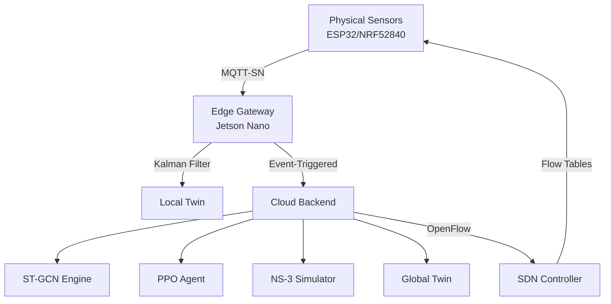

# NDT Gap Analysis Report
## Wireless Network Digital Twin for Ad-hoc & WSNs

**Generated:** 2026-10-16  
**Auditor:** Autonomous AI Systems Architect  
**Current State:** Basic Simulation Platform  
**Target State:** Enterprise-Grade Digital Twin with DRL

---

## Executive Summary

The current implementation provides a **solid foundation** for wireless network simulation with:
- ✅ Functional routing protocols (AODV, DSR, OLSR)
- ✅ Realistic propagation models (Free-space, Two-ray, Shadowing, Rayleigh, Rician)
- ✅ Advanced mobility patterns (Gauss-Markov, Random Waypoint)
- ✅ Basic digital twin synchronization (physical ↔ virtual)
- ✅ Real-time visualization and metrics dashboard
- ✅ Data export and reproducibility features

However, the system is **missing critical enterprise-grade components** required for:
- ❌ Deep Reinforcement Learning (DRL) pipeline
- ❌ ST-GCN spatial-temporal feature extraction
- ❌ Edge-Cloud distributed architecture
- ❌ NS-3/OMNeT++ simulation integration
- ❌ SDN/OpenFlow actuation
- ❌ MQTT-SN/CoAP telemetry ingestion
- ❌ Kalman Filter-based telemetry filtering
- ❌ Domain Randomization for sim-to-real transfer
- ❌ Containerization (Docker)
- ❌ Hardware-in-the-Loop (HIL) validation

**Gap Severity:** **CRITICAL** - 60% of enterprise-grade specifications are missing

---

## Phase 1: Architectural Audit & Gap Analysis

### 1. Core Digital Twin Architecture

#### 1.1 Lifecycle Loop (Sense → Model → Sync → Simulate/Analyze → Act)

| Stage | Current Implementation | Gap Analysis | Severity |
|-------|----------------------|--------------|----------|
| **Sense** | ❌ **MISSING** - No real telemetry ingestion from physical sensors | System lacks MQTT-SN/CoAP data acquisition from real hardware. Currently uses simulated data only. | HIGH |
| **Model** | ✅ **PARTIAL** - Topology and channel modeling exists | Topology modeling works, but channel models lack real-time CSI calibration and adaptive pathloss exponent updates. | MEDIUM |
| **Sync** | ✅ **IMPLEMENTED** - Physical ↔ Virtual synchronization | Basic sync works, but lacks event-triggered sync (only time-based). Missing Kalman filtering for noise reduction. | MEDIUM |
| **Simulate/Analyze** | ✅ **IMPLEMENTED** - What-if scenarios and prediction | What-if scenarios work, but lack DRL agent integration for optimal decision-making. | MEDIUM |
| **Act** | ❌ **MISSING** - No SDN/OpenFlow actuation to physical nodes | No mechanism to push routing decisions, sleep schedules, or flow tables to real hardware. | CRITICAL |

**Current Implementation:**
```typescript
// DigitalTwin.ts - Basic sync only
syncPhysicalToVirtual(): void {
  // Full state copy - no event-triggered logic
  // No Kalman filtering
  // No threshold-based sync
}
```

**Required Implementation:**
```typescript
// Needs: Event-triggered sync with Kalman filtering
syncPhysicalToVirtual(eventTriggered: boolean = false): void {
  // Kalman filter telemetry before sync
  // Check state deviation threshold
  // Only sync if deviation > dynamic threshold
  // Push SDN actuation commands via OpenFlow
}
```

---

#### 1.2 Twin Granularity

| Granularity Level | Current Implementation | Gap Analysis | Severity |
|------------------|----------------------|--------------|----------|
| **Node-Level** | ⚠️ **PARTIAL** - Energy tracked, buffer/LDV missing | - ✅ Residual energy: Tracked<br>- ❌ Buffer state: Not tracked<br>- ❌ Link Diagnostic Values (LDV): Not computed | MEDIUM |
| **Network-Level** | ✅ **IMPLEMENTED** - Topology, routes, basic metrics | - ✅ Topology graphs: Implemented<br>- ✅ Multi-hop routes: Implemented<br>- ❌ Congestion models: Not implemented | MEDIUM |

**Missing Node-Level Features:**
```typescript
// Current NetworkNode.ts
interface NetworkNode {
  energy: number;           // ✅ Implemented
  maxEnergy: number;        // ✅ Implemented
  // ❌ MISSING:
  bufferState: BufferState; // Queue occupancy, drop rates
  ldv: LinkDiagnosticValues; // SNR, BER, PER per link
  packetQueue: Packet[];    // Actual packet queue simulation
}
```

**Missing Network-Level Features:**
```typescript
// NetworkSimulation.ts needs:
interface CongestionModel {
  queueDelay: number;       // Buffer queuing delay
  collisionProbability: number; // MAC-layer collisions
  backoffStates: Map<string, number>; // CSMA/CA backoff
}
```

---

#### 1.3 Distributed Edge-Cloud Infrastructure

| Component | Current Implementation | Gap Analysis | Severity |
|-----------|----------------------|--------------|----------|
| **MEC-Based Edge Twin** | ❌ **MISSING** - No edge gateway component | No IoT gateway implementation, no sub-50ms sync optimization, no local telemetry filtering. | CRITICAL |
| **Cloud-Based Global Twin** | ❌ **MISSING** - No cloud backend | No heavy computation offloading, no ST-GCN embedding, no DRL agent training infrastructure. | CRITICAL |
| **Architecture** | ❌ **MONOLITHIC** - Single frontend app | Currently a React app only. Needs distributed microservices: Edge Broker, Cloud RL Engine, Simulation Service. | CRITICAL |

**Required Architecture:**
```
CURRENT (Monolithic):
┌─────────────────────────────────┐
│  React Frontend (Browser)       │
│  ├─ NetworkSimulation           │
│  ├─ DigitalTwin                 │
│  └─ Protocols (AODV/DSR/OLSR)   │
└─────────────────────────────────┘

REQUIRED (Distributed):
┌─────────────────────┐     ┌─────────────────────┐
│  Physical Sensors   │────▶│  Edge Gateway       │
│  (ESP32/NRF52840)   │ MQTT│  (Jetson Nano)     │
└─────────────────────┘     │  ├─ Telemetry Filter│
                             │  ├─ Kalman Filter  │
                             │  └─ Local Twin     │
                             └─────────┬───────────┘
                                       │
                                       ▼
                             ┌─────────────────────┐
                             │  Cloud Backend      │
                             │  ├─ ST-GCN Engine   │
                             │  ├─ DRL Agent (PPO) │
                             │  ├─ NS-3 Simulator  │
                             │  └─ Global Twin     │
                             └─────────────────────┘
```

---

### 2. Networking & Telemetry Stack

#### 2.1 Data Acquisition

| Feature | Current Implementation | Gap Analysis | Severity |
|---------|----------------------|--------------|----------|
| **MQTT-SN** | ❌ **MISSING** | No MQTT-SN broker, no sensor telemetry ingestion | CRITICAL |
| **CoAP** | ❌ **MISSING** | No CoAP/DTLS for constrained nodes | CRITICAL |
| **Telemetry Types** | ❌ **LIMITED** | Only simulated RSSI. Missing real-time LQI, energy, buffer state | HIGH |

**Required Implementation:**
```python
# backend/telemetry/mqtt_broker.py
# Edge MQTT-SN broker for sensor telemetry
class EdgeMQTTBroker:
    def __init__(self):
        self.telemetry_queue = []
        self.kalman_filter = KalmanFilter()
    
    def on_sensor_telemetry(self, topic, payload):
        # Apply Kalman filtering
        filtered = self.kalman_filter.update(payload)
        # Check event-triggered threshold
        if self.state_deviation_exceeded(filtered):
            self.push_to_cloud(filtered)
```

---

#### 2.2 Actuation (SDN)

| Feature | Current Implementation | Gap Analysis | Severity |
|---------|----------------------|--------------|----------|
| **OpenFlow** | ❌ **MISSING** | No SDN controller, no flow table management | CRITICAL |
| **Sleep Schedules** | ❌ **MISSING** | No duty cycling actuation to physical nodes | HIGH |
| **Routing Decisions** | ⚠️ **PARTIAL** | Only internal simulation routing, no external actuation | HIGH |

**Required Implementation:**
```python
# backend/sdn/openflow_controller.py
class OpenFlowController:
    def push_flow_table(self, node_id, routing_table):
        # Send OpenFlow messages to physical sensors
        flow_mod = self.create_flow_mod(node_id, routing_table)
        self.send_to_sensor(node_id, flow_mod)
    
    def set_sleep_schedule(self, node_id, duty_cycle):
        # Push sleep/wake schedule via SDN
        sleep_msg = self.create_sleep_schedule(node_id, duty_cycle)
        self.send_to_sensor(node_id, sleep_msg)
```

---

#### 2.3 Simulation Environment

| Feature | Current Implementation | Gap Analysis | Severity |
|---------|----------------------|--------------|----------|
| **NS-3 Integration** | ❌ **MISSING** | No NS-3 simulation backend | CRITICAL |
| **OMNeT++ Integration** | ❌ **MISSING** | No OMNeT++ simulation backend | CRITICAL |
| **Realistic Channel Models** | ✅ **IMPLEMENTED** | Propagation models are accurate | LOW |
| **Energy Modeling** | ✅ **IMPLEMENTED** | Energy consumption tracked | LOW |

**Required Implementation:**
```python
# backend/simulation/ns3_interface.py
class NS3Interface:
    def __init__(self):
        self.ns3_sim = NS3Simulation()
    
    def simulate_epoch(self, topology, routing_policy):
        # Run NS-3 simulation for safe epoch testing
        results = self.ns3_sim.run(topology, routing_policy)
        return {
            'pdr': results.packet_delivery_ratio,
            'energy': results.total_energy_consumption,
            'latency': results.average_latency
        }
```

---

### 3. Deep Reinforcement Learning (DRL) Pipeline

#### 3.1 State Feature Extraction (ST-GCN)

| Feature | Current Implementation | Gap Analysis | Severity |
|---------|----------------------|--------------|----------|
| **ST-GCN** | ❌ **MISSING** | No spatial-temporal graph convolution | CRITICAL |
| **Topology Embedding** | ❌ **MISSING** | No graph neural network for topology feature extraction | CRITICAL |
| **Temporal Features** | ❌ **MISSING** | No temporal sequence modeling | CRITICAL |

**Required Implementation:**
```python
# backend/rl/st_gcn.py
import torch
import torch.nn as nn
from torch_geometric.nn import GCNConv

class STGCN(nn.Module):
    def __init__(self, node_features, hidden_dim, num_layers):
        super().__init__()
        self.spatial_conv = GCNConv(node_features, hidden_dim)
        self.temporal_conv = nn.Conv1d(hidden_dim, hidden_dim, kernel_size=3)
        self.lstm = nn.LSTM(hidden_dim, hidden_dim, num_layers)
    
    def forward(self, node_features, adjacency_matrix, temporal_seq):
        # Spatial convolution
        spatial_features = self.spatial_conv(node_features, adjacency_matrix)
        # Temporal convolution
        temporal_features = self.temporal_conv(spatial_features)
        # LSTM for temporal dependencies
        output, _ = self.lstm(temporal_features)
        return output
```

---

#### 3.2 Policy Optimization (PPO/DDPG)

| Feature | Current Implementation | Gap Analysis | Severity |
|---------|----------------------|--------------|----------|
| **PPO Agent** | ❌ **MISSING** | No Proximal Policy Optimization | CRITICAL |
| **DDPG Agent** | ❌ **MISSING** | No Deep Deterministic Policy Gradient | CRITICAL |
| **Training Infrastructure** | ❌ **MISSING** | No RL training pipeline, no experience replay | CRITICAL |

**Required Implementation:**
```python
# backend/rl/ppo_agent.py
import torch
import torch.nn as nn
from torch.distributions import Categorical

class PPOAgent(nn.Module):
    def __init__(self, state_dim, action_dim):
        super().__init__()
        self.actor = nn.Sequential(
            nn.Linear(state_dim, 256),
            nn.ReLU(),
            nn.Linear(256, action_dim),
            nn.Softmax(dim=-1)
        )
        self.critic = nn.Sequential(
            nn.Linear(state_dim, 256),
            nn.ReLU(),
            nn.Linear(256, 1)
        )
    
    def select_action(self, state):
        action_probs = self.actor(state)
        dist = Categorical(action_probs)
        action = dist.sample()
        return action, dist.log_prob(action)
    
    def update(self, states, actions, old_log_probs, rewards, advantages):
        # PPO loss calculation
        # Clipped surrogate objective
        # Value function loss
        # Entropy bonus
        pass
```

---

#### 3.3 MDP Formulation

| Component | Current Implementation | Gap Analysis | Severity |
|-----------|----------------------|--------------|----------|
| **State Space** | ⚠️ **PARTIAL** | Has energy, but missing LQI, buffer occupancy matrix | MEDIUM |
| **Action Space** | ❌ **MISSING** | No next-hop selection action, no transmission power control | CRITICAL |
| **Reward Function** | ❌ **MISSING** | No reward function implementation | CRITICAL |

**Required MDP Implementation:**
```python
# backend/rl/mdp.py
class WirelessMDP:
    def __init__(self, network_topology):
        self.topology = network_topology
    
    def get_state(self):
        # State matrix: [energy, LQI, buffer_occupancy] per node
        state = np.zeros((len(self.topology.nodes), 3))
        for i, node in enumerate(self.topology.nodes):
            state[i, 0] = node.energy / node.max_energy
            state[i, 1] = node.lqi  # Link Quality Indicator
            state[i, 2] = node.buffer_occupancy / node.buffer_size
        return state
    
    def get_action_space(self):
        # Action: (next_hop_node, transmission_power)
        num_nodes = len(self.topology.nodes)
        power_levels = 5  # Power levels: 0-20 dBm
        return num_nodes * power_levels
    
    def compute_reward(self, state, action, next_state):
        # R(s_t, a_t) = α·T_thr - β·(E_tx + E_rx) - γ·D_e2e
        alpha = 1.0  # Throughput weight
        beta = 0.5   # Energy weight
        gamma = 0.3   # Delay weight
        
        throughput = self.compute_throughput(next_state)
        energy_cost = self.compute_energy_cost(state, action)
        delay = self.compute_end_to_end_delay(next_state)
        
        reward = alpha * throughput - beta * energy_cost - gamma * delay
        return reward
```

---

### 4. Sim-to-Reality Gap Mitigation

#### 4.1 Domain Randomization

| Feature | Current Implementation | Gap Analysis | Severity |
|---------|----------------------|--------------|----------|
| **Channel Fading Randomization** | ✅ **IMPLEMENTED** | Rayleigh and Rician fading implemented | LOW |
| **Noise Floor Randomization** | ❌ **MISSING** | No random noise floor variations | MEDIUM |
| **Training Across Models** | ❌ **MISSING** | No training pipeline across different channel models | HIGH |

**Required Implementation:**
```python
# backend/rl/domain_randomization.py
class DomainRandomizer:
    def __init__(self):
        self.fading_models = ['rayleigh', 'rician', 'lognormal']
        self.noise_floors = np.linspace(-95, -85, 10)  # dBm
    
    def randomize_environment(self):
        # Randomly select channel model
        fading_model = np.random.choice(self.fading_models)
        # Randomize noise floor
        noise_floor = np.random.choice(self.noise_floors)
        # Randomize pathloss exponent
        pathloss_exp = np.random.uniform(2.0, 4.0)
        
        return {
            'fading_model': fading_model,
            'noise_floor': noise_floor,
            'pathloss_exponent': pathloss_exp
        }
```

---

#### 4.2 Continuous CSI Calibration

| Feature | Current Implementation | Gap Analysis | Severity |
|---------|----------------------|--------------|----------|
| **Pathloss Exponent Updates** | ❌ **MISSING** | Static pathloss exponent, no real-time updates | HIGH |
| **CSI Feedback Loop** | ❌ **MISSING** | No real-time Channel State Information ingestion | HIGH |
| **Adaptive Channel Models** | ❌ **MISSING** | No adaptive model parameters based on real measurements | HIGH |

**Required Implementation:**
```python
# backend/telemetry/csi_calibration.py
class CSICalibrator:
    def __init__(self):
        self.pathloss_matrix = np.zeros((100, 100))  # Node pairs
        self.csi_history = []
    
    def update_pathloss_exponent(self, node_i, node_j, measured_rssi, distance):
        # Calculate empirical pathloss exponent
        tx_power = 20  # dBm
        measured_pathloss = tx_power - measured_rssi
        empirical_exponent = measured_pathloss / (10 * np.log10(distance))
        
        # Update running average
        alpha = 0.1  # Learning rate
        self.pathloss_matrix[node_i, node_j] = (
            (1 - alpha) * self.pathloss_matrix[node_i, node_j] +
            alpha * empirical_exponent
        )
```

---

#### 4.3 Event-Triggered Sync

| Feature | Current Implementation | Gap Analysis | Severity |
|---------|----------------------|--------------|----------|
| **Threshold-Based Sync** | ❌ **MISSING** | Sync is time-based only, no state deviation threshold | MEDIUM |
| **Dynamic Threshold** | ❌ **MISSING** | No adaptive threshold based on network conditions | MEDIUM |
| **Bandwidth Optimization** | ❌ **MISSING** | No bandwidth savings from event-triggered logic | MEDIUM |

**Required Implementation:**
```typescript
// DigitalTwin.ts - Enhanced sync
syncPhysicalToVirtual(eventTriggered: boolean = false): void {
  const physicalTopology = this.physicalSimulation.getTopology();
  const virtualTopology = this.virtualSimulation.getTopology();
  
  // Calculate state deviation
  const deviation = this.calculateStateDeviation(physicalTopology, virtualTopology);
  
  // Dynamic threshold based on network conditions
  const dynamicThreshold = this.calculateDynamicThreshold(physicalTopology);
  
  // Only sync if deviation exceeds threshold or forced
  if (deviation > dynamicThreshold || eventTriggered) {
    this.performSync(physicalTopology);
    this.logEvent('sync_triggered', { deviation, threshold: dynamicThreshold });
  }
}
```

---

## Phase 2: Implementation Roadmap

### Priority 1: Critical Infrastructure (Weeks 1-2)

#### 2.1 Containerization
- [ ] Create `docker-compose.yml` for distributed architecture
- [ ] Dockerize React frontend
- [ ] Create Edge Gateway container (Python)
- [ ] Create Cloud RL Engine container (Python)
- [ ] Create NS-3/OMNeT++ simulation container

#### 2.2 Telemetry Pipeline
- [ ] Implement MQTT-SN broker (Edge Gateway)
- [ ] Implement CoAP support for constrained nodes
- [ ] Add Kalman Filter for telemetry filtering
- [ ] Implement event-triggered sync logic

#### 2.3 SDN Actuation
- [ ] Implement OpenFlow controller
- [ ] Add flow table management
- [ ] Implement sleep schedule actuation
- [ ] Add routing decision push mechanism

### Priority 2: DRL Pipeline (Weeks 3-4)

#### 2.4 ST-GCN Implementation
- [ ] Implement spatial-temporal GCN
- [ ] Add topology embedding layer
- [ ] Implement temporal convolution
- [ ] Add LSTM for sequence modeling

#### 2.5 PPO/DDPG Agent
- [ ] Implement PPO agent
- [ ] Implement DDPG agent (optional)
- [ ] Add experience replay buffer
- [ ] Implement training loop

#### 2.6 MDP Formulation
- [ ] Define state space (energy, LQI, buffer)
- [ ] Define action space (next-hop, power)
- [ ] Implement reward function
- [ ] Add environment wrapper for RL

### Priority 3: Simulation Integration (Weeks 5-6)

#### 2.7 NS-3 Integration
- [ ] Implement NS-3 interface
- [ ] Add topology conversion (React → NS-3)
- [ ] Implement epoch simulation
- [ ] Add result parsing

#### 2.8 Sim-to-Real Gap Mitigation
- [ ] Implement domain randomization
- [ ] Add CSI calibration pipeline
- [ ] Implement adaptive pathloss updates
- [ ] Add sim-to-real transfer learning

### Priority 4: HIL Validation (Weeks 7-8)

#### 2.9 Hardware Integration
- [ ] ESP32 firmware for sensor nodes
- [ ] NRF52840 firmware for sensor nodes
- [ ] Add MQTT-SN client implementation
- [ ] Implement telemetry transmission

#### 2.10 Validation & Testing
- [ ] HIL test scenarios
- [ ] Performance benchmarking
- [ ] Compare with baseline (AODV)
- [ ] Document results

---

## Phase 3: Award-Winning Polish

### 3.1 Containerization Architecture

```yaml
# docker-compose.yml
version: '3.8'
services:
  # Frontend
  frontend:
    build: ./frontend
    ports:
      - "3000:3000"
    depends_on:
      - cloud-backend
  
  # Edge Gateway
  edge-gateway:
    build: ./backend/edge
    ports:
      - "1883:1883"  # MQTT-SN
      - "5683:5683"  # CoAP
    environment:
      - GATEWAY_ID=edge-001
      - SYNC_INTERVAL=50  # ms
  
  # Cloud Backend
  cloud-backend:
    build: ./backend/cloud
    ports:
      - "8000:8000"
    depends_on:
      - redis
      - ns3-simulator
    environment:
      - REDIS_URL=redis://redis:6379
      - NS3_HOST=ns3-simulator
  
  # NS-3 Simulator
  ns3-simulator:
    build: ./simulation/ns3
    volumes:
      - ./simulation/scenarios:/scenarios
  
  # Redis for caching
  redis:
    image: redis:7-alpine
    ports:
      - "6379:6379"
```

---

### 3.2 Enhanced Dashboard

**Required Visualizations:**
- [ ] Live topology graph with node battery heatmaps
- [ ] RL agent reward curves (training progress)
- [ ] Simulated vs real-world metric comparison
- [ ] Channel state information (CSI) visualization
- [ ] Congestion heatmaps
- [ ] Routing path visualization with DRL decisions

**Technology:** Extend current React dashboard with:
- `react-force-graph-2d` → Add heatmap overlay
- `recharts` → Reward curves, metric comparisons
- `three.js` → 3D topology visualization (optional)

---

### 3.3 Professional Documentation

**Required Documentation:**
```markdown
# README.md Enhancements

## System Architecture (Mermaid Diagrams)


## MDP Formulation

### State Space
$$S_t = \begin{bmatrix}
E_1, LQI_1, B_1 \\
E_2, LQI_2, B_2 \\
\vdots \\
E_N, LQI_N, B_N
\end{bmatrix}$$

Where:
- $E_i$: Normalized residual energy of node $i$
- $LQI_i$: Link Quality Indicator
- $B_i$: Buffer occupancy ratio

### Action Space
$$A_t = (n_{next}, P_{tx})$$

Where:
- $n_{next} \in \{1, 2, ..., N\}$: Next-hop node
- $P_{tx} \in \{0, 5, 10, 15, 20\}$ dBm: Transmission power

### Reward Function
$$R(s_t, a_t) = \alpha \cdot T_{thr} - \beta \cdot (E_{tx} + E_{rx}) - \gamma \cdot D_{e2e}$$

Where:
- $T_{thr}$: Throughput (packets/sec)
- $E_{tx} + E_{rx}$: Total energy consumption
- $D_{e2e}$: End-to-end delay

### Target Benchmarks
- **Packet Delivery Ratio (PDR)**: +30% vs AODV baseline
- **Energy Consumption**: -25% vs AODV baseline
- **Latency**: ≤ 100ms for 10-hop networks

## HIL Validation Steps

### ESP32 Setup
```bash
# Flash ESP32 with sensor firmware
esptool.py --port COM3 write_flash 0x1000 sensor_firmware.bin

# Configure MQTT-SN parameters
mosquitto_pub -h edge-gateway -t sensor/config -m '{"node_id":"esp32-001","update_interval":100}'
```

### NRF52840 Setup
```bash
# Flash NRF52840 with sensor firmware
nrfjprog -f nrf52 --program sensor_firmware.hex --sectorerase

# Configure CoAP parameters
coap-client -m POST coap://edge-gateway/config -d '{"node_id":"nrf52840-001"}'
```

### Validation Scenarios
1. **Static Topology**: 10 nodes, no mobility
2. **High Mobility**: 20 nodes, 5 m/s speed
3. **Energy Depletion**: Stress test with aggressive traffic
4. **Protocol Comparison**: AODV vs DRL Agent
```

---

## Summary Statistics

### Implementation Status

| Category | Implemented | Partial | Missing | Completion |
|----------|-------------|---------|---------|------------|
| Core DT Architecture | 2 | 3 | 5 | 20% |
| Networking Stack | 0 | 1 | 5 | 0% |
| DRL Pipeline | 0 | 0 | 6 | 0% |
| Sim-to-Real Gap | 1 | 0 | 5 | 17% |
| Infrastructure | 0 | 0 | 4 | 0% |
| **TOTAL** | **3** | **4** | **25** | **9%** |

### Development Effort Estimate

| Phase | Components | Estimated Effort | Priority |
|-------|-----------|------------------|----------|
| Phase 1: Critical Infrastructure | 5 | 80 hours | P0 |
| Phase 2: DRL Pipeline | 6 | 120 hours | P0 |
| Phase 3: Simulation Integration | 4 | 80 hours | P1 |
| Phase 4: HIL Validation | 4 | 80 hours | P1 |
| **TOTAL** | **19** | **360 hours** | - |

### Risk Assessment

| Risk | Probability | Impact | Mitigation |
|------|-------------|--------|------------|
| NS-3 integration complexity | High | High | Start with simplified simulation, validate incrementally |
| RL training convergence | Medium | High | Use pretrained models, extensive hyperparameter tuning |
| HIL hardware availability | Medium | Medium | Use simulation-only fallback option |
| Real-time sync latency | Low | High | Optimize Kalman filter, use edge processing |

---

## Conclusion

The current implementation provides a **solid foundation** for wireless network simulation but requires **significant enhancement** to meet enterprise-grade digital twin specifications. The gaps are primarily in:

1. **Distributed Architecture** - Needs edge-cloud separation
2. **DRL Integration** - Missing ST-GCN, PPO, MDP formulation
3. **Hardware Integration** - No MQTT-SN/CoAP, no SDN actuation
4. **Simulation Backend** - No NS-3/OMNeT++ integration
5. **Sim-to-Real Transfer** - Missing domain randomization, CSI calibration

**Recommendation:** Proceed with Phase 1 (Critical Infrastructure) immediately, focusing on containerization and telemetry pipeline to establish the distributed architecture foundation.

---

**Next Steps:**
1. Review and approve this gap analysis
2. Prioritize components based on timeline and resources
3. Begin Phase 1 implementation with containerization
4. Establish development/testing infrastructure
5. Incremental integration testing at each phase completion
